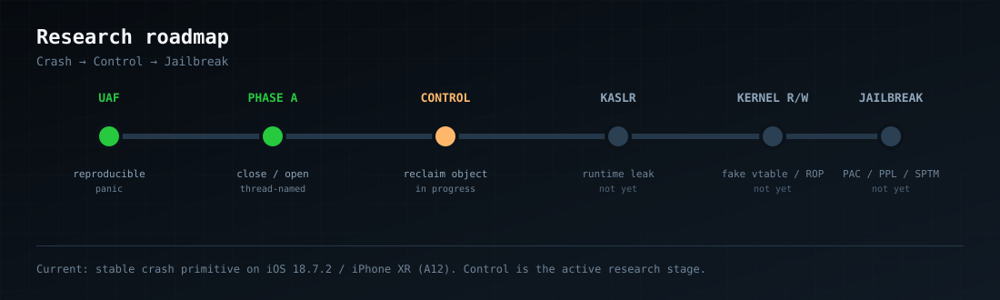

<p align="center">
  
</p>

<p align="center">
  
  
  
  
  
  <a href="https://github.com/nenasevartem70-cmyk/hidgate-poc/actions/workflows/build.yml"></a>
</p>

# iOS 18.7.2 / A12 — kernel control research

Two kernel bugs on the spare iPhone XR, researched from Windows/WSL with no
Mac in the loop:

- **CVE-2026-28992** — IOHIDFamily fast-path open/teardown race. Stable
  kernel panic, but **crash-only** on the reachable SPU provider.
- **CVE-2026-20687** — AppleJPEGDriver decoder timeout UAF. Reproducible
  deferred panic, controlled 10 s free, and same-type reclaim without a
  panic.

> **This is not a jailbreak. No kernel read/write yet.**
> The repository documents the crash → UAF → controlled free/reclaim ladder.
> It does not bypass PAC/PPL/SPTM, does not install anything, and does not
> provide arbitrary kernel memory access.

> **«Паника — это не конец. Это доказательство, что мы уже в ядре.»**
> **Crash → Control → Jailbreak.**

## Kernel control status

| Level | State |
|---|---|
| 0. Crash | **PASS** — IOHID and AppleJPEG signatures reproduced |
| 1. Reproducible UAF | **PASS** — AppleJPEG `JpegRequest` read after free |
| 2. Controlled free | **PASS** — `sel1` sync returns `kIOReturnTimeout` after 10.001 s |
| 3. Same-type reclaim | **PASS** — 10 async allocations after the timeout, kernel survives |
| 4. Persistent stale node | **PARTIAL** — immediate close produces a `setPowerState` wedge |
| 5. Write / read primitive | **NOT YET** |
| 6. PAC / PPL bypass | **NOT YET** |
| 7. Kernel r/w + jailbreak | **NOT YET** |

The direct PC-control path from the public PoC is PAC-protected on A12
(`autda` + `blraa`), so the next gate is a double-free/write primitive, not a
fake vtable. Read the full reasoning in
[`docs/kernel-control.md`](docs/kernel-control.md).

The jailbreak project built on this research is
**[Hidra](https://github.com/nenasevartem70-cmyk/hidra)** — target device,
architecture, milestones, and the current release estimate live there.

## IOHID path — CVE-2026-28992

### Status

| Item | Value |
|---|---|
| CVE | CVE-2026-28992 |
| Component | `com.apple.iokit.IOHIDFamily` — `IOHIDEventServiceFastPathUserClient` |
| Bug class | Race condition / use-after-free |
| Reachable from | Normal app sandbox, no entitlements required |
| Patched in | iOS 18.7.9 / iPadOS 18.7.9 and iOS 26.5 / iPadOS 26.5 |
| Tested on | iPhone XR (`iPhone11,8`), iOS 18.7.2 (22H124), A12 |
| Result | Kernel data abort / panic, device reboots |
| Control status | Crash-only on the reachable SPU provider |

The IOHID fast-path object is provider-side: `copyEvent` never delivers an
event on this target (245,808 attempts, all `kIOReturnNoResources`), so the
free cannot be raced from userland. The next control lead is
[CVE-2026-20687 in AppleJPEGDriver](docs/applejpeg-cve-2026-20687.md).

The original IOHID research and PoC were published by **Johnny Franks
(@0xjohnny)**. This repository contains a standalone build of the same
technique, with service enumeration and a panic-log analysis from the
18.7.2/A12 target.

## Research roadmap

<p align="center">
  
</p>

The roadmap below is the original IOHID path; the current AppleJPEG ladder is
the table at the top of this README.

## Patch timeline

<p align="center">
  
</p>

## Root cause

`IOHIDEventServiceFastPathUserClient` gates `sel0` on the
`FastPathHasEntitlement` and `FastPathMotionEventEntitlement` keys in the
**caller-supplied OSDictionary**, instead of the entitlement flags stored
during `initWithTask`. A sandboxed app can therefore pass the gate by putting
those keys in its input dictionary.

Two connections to the same `IOHIDEventService` provider then operate in
different locking domains:

- `sel1` (close) drops provider state and clears `+0x109` without the lock;
- `sel2` (copyEvent) checks `+0x108` under a per-connection lock and then
  calls into the provider.

The AOP variant additionally uses `mach_port_destroy` on probe connections to
fire asynchronous `didTerminate`/teardown while opener threads walk the same
provider state.

<p align="center">
  
</p>

## What this PoC does

1. Enumerates every `IOHIDEventService` in the IORegistry.
2. Opens up to 32 `type=2` user clients per service and gates each one with
   the entitlement-bypass XML dictionary.
3. Picks the first provider with at least two successful gates.
4. Keeps eight gated connections.
5. Runs three `close`/reopen churn threads.
6. For 120 seconds, repeatedly opens 16 probe connections, gates them, and
   destroys them with `mach_port_destroy` (80 ms race window).

On the tested 18.7.2/A12 device, this crashes in the provider's
open/teardown path.

## Expected panic

```
Panicked task ... pid ...: hidgate4
Kernel data abort
pc  = 0xfffffff02405c388
x16 = 0x0020000000000000
far = 0x0020000000000038
esr = 0x96000004

0xfffffff008424388:  ldr x8, [x16, #0x38]!
```

<p align="center">
  
</p>

The faulting instruction is a virtual call through a corrupted object
pointer. The backtrace contains `IOHIDFamily` and `AppleSPU`, which is
consistent with the FastPath open/teardown race.

See [`docs/panic-analysis.md`](docs/panic-analysis.md) for the redacted
analysis.

## AppleJPEG path — CVE-2026-20687

Apple: *"An app may be able to cause unexpected system termination or write
kernel memory."* Fixed in iOS 18.7.7 / iPadOS 18.7.7 and iOS 26.4 / iPadOS
26.4. The 18.7.2 kext is `AppleJPEGDriver 7.6.9`.

What works on the test device:

1. `IOServiceOpen("AppleJPEGDriver", type 0)` succeeds from the app sandbox.
2. `sel1` accepts the `0x58`-byte `AppleJPEGDriverIOStruct`; both sync and
   async decodes work.
3. Five async decodes plus `close`, then Camera, produce a deferred kernel
   data abort inside `AppleJPEGDriver`:

```
pc  = ... (AppleJPEGDriver)
x5  = 0xfeedfacefeedfacf
x6  = 0xfeedfacefeedfacf
x12 = 0
far = 0x308

0xfffffff008df3418:  ldrb w12, [x12, #0x308]
```

4. An 8000-request mass prime drives a true sync decode into
   `kIOReturnTimeout` (`0xe00002d6`, `dt=10.001s`).
5. Ten async requests on the same connection immediately after the timeout
   reclaim the freed `JpegRequest`; the kernel survives.
6. Closing immediately after the reclaim leaves the driver wedged in
   `setPowerState(1 -> 0)` (10.2 s watchdog). That is a DoS, not control.

Full details:

- [`docs/applejpeg-cve-2026-20687.md`](docs/applejpeg-cve-2026-20687.md)
- [`docs/applejpeg-panic-2026-10-30.md`](docs/applejpeg-panic-2026-10-30.md)
- [`docs/kernel-control.md`](docs/kernel-control.md)
- Sources: [`experiments/applejpeg/`](experiments/applejpeg/)

## Final tests

The reproducible test matrix (T1–T8), exact log lines, pass/fail criteria,
and log-collection steps are in
[`docs/final-tests.md`](docs/final-tests.md).

## Build

No prebuilt `.ipa` is committed. Build it yourself from source and sign it
with your own certificate or sideloading tool.

### One command (macOS)

```bash
make
# or: ./build.sh
```

This produces:

```
build/Payload/hidgate4.app
build/hidgate4-unsigned.ipa
```

The IPA is unsigned. Sign it with your normal workflow (Xcode, `codesign`,
`ldid`, AltStore, TrollStore, etc.) before installing.

### Xcode

1. Create a new iOS App project (Objective-C, UIKit).
2. Replace `ViewController.m`/`main.m` with [`PoC/main.m`](PoC/main.m).
3. Add `IOKit.framework` and `Foundation.framework`.
4. Set a bundle identifier and sign with your development team.
5. Install on a test device you own and launch.

### Manual command line (macOS)

```bash
SDK=$(xcrun --sdk iphoneos --show-sdk-path)
xcrun -sdk iphoneos clang -arch arm64 -isysroot "$SDK" -fobjc-arc -fblocks \
  -O2 -c PoC/main.m -o main.o
xcrun -sdk iphoneos clang -arch arm64 -isysroot "$SDK" \
  -o hidgate4 main.o -framework UIKit -framework Foundation -framework IOKit
python3 scripts/package_ipa.py hidgate4.app hidgate4-unsigned.ipa
```

### GitHub Actions

The workflow in `.github/workflows/build.yml` builds an unsigned IPA on a
macOS runner and uploads it as the `hidgate4-unsigned-ipa` artifact. You can
run it manually from the Actions tab.

## Research log

The full crash-to-control log is
[`docs/experiment-log.md`](docs/experiment-log.md). Variant sources live in
[`experiments/`](experiments/) and
[`experiments/applejpeg/`](experiments/applejpeg/).

Short version:

- IOHID `close`/`open` is the trigger; generic and targeted sprays did not
  reclaim the provider-side object. `copyEvent` never delivers an event on
  this SPU, so the IOHID path is crash-only.
- AppleJPEG `sel1` sync/async works from the app sandbox. The deferred UAF is
  reproducible via Camera, and the 10 s timeout can be forced on demand.
- The same-type reclaim after the timeout survives; immediate close produces
  a power-state wedge. The next goal is a double-free/write primitive, not a
  fake vtable.

## Project page (GitHub Pages)

The `docs/` directory contains a self-contained dark landing page with the
banner, race diagram, panic card, and timeline.

To enable it:

1. Repository **Settings → Pages**
2. **Build and deployment → Deploy from a branch**
3. Branch `main`, folder `/docs`
4. Save

After that the page is available at:

**https://nenasevartem70-cmyk.github.io/hidgate-poc/**

Instant preview without enabling Pages:

**https://raw.githack.com/nenasevartem70-cmyk/hidgate-poc/main/docs/index.html**

## Direct links

### Repository docs

- Kernel control ladder: [`docs/kernel-control.md`](docs/kernel-control.md)
- Final test matrix (T1–T8): [`docs/final-tests.md`](docs/final-tests.md)
- AppleJPEG CVE notes: [`docs/applejpeg-cve-2026-20687.md`](docs/applejpeg-cve-2026-20687.md)
- AppleJPEG panic analysis: [`docs/applejpeg-panic-2026-10-30.md`](docs/applejpeg-panic-2026-10-30.md)
- Full experiment log: [`docs/experiment-log.md`](docs/experiment-log.md)
- IOHID panic analysis: [`docs/panic-analysis.md`](docs/panic-analysis.md)
- AppleJPEG sources: [`experiments/applejpeg/`](experiments/applejpeg/)

### CVE-2026-20687 (AppleJPEGDriver)

- Apple security content, iOS 26.4 / iPadOS 26.4:
  https://support.apple.com/en-us/126792
- Apple security content, iOS 18.7.7 / iPadOS 18.7.7:
  https://support.apple.com/en-us/126793
- CVE record: https://www.cve.org/CVERecord?id=CVE-2026-20687
- NVD: https://nvd.nist.gov/vuln/detail/CVE-2026-20687
- Public PoC: https://github.com/0xjohnnydev/CVE-2026-20687-AppleJPEGDriver-UAF

### CVE-2026-28992 (IOHIDFamily)

- CVE record: https://www.cve.org/CVERecord?id=CVE-2026-28992
- NVD: https://nvd.nist.gov/vuln/detail/CVE-2026-28992
- Public PoC:
  https://github.com/0xjohnnydev/CVE-2026-28992-IOHIDFamily-FastPathUserClient-Race-Conditions
- Independent research:
  https://github.com/clogan9019-dotcom/IOHIDFamily-PoC-Research

## Warning

- The IOHID PoC **will** panic the kernel and reboot the device.
- The AppleJPEG builds can panic, reboot, or wedge the JPEG driver's power
  state (`setPowerState(1 -> 0)` timeout).
- Do not run any of this on a primary phone.
- Save your work first.
- The PoCs are intentionally aggressive: the IOHID baseline keeps 16 probe
  connections every 80 ms for 120 seconds; the AppleJPEG prime can submit
  thousands of decodes.

## Credits

- **Johnny Franks (@0xjohnny)** — discovery and original PoCs:
  - IOHID: https://github.com/0xjohnnydev/CVE-2026-28992-IOHIDFamily-FastPathUserClient-Race-Conditions
  - AppleJPEG: https://github.com/0xjohnnydev/CVE-2026-20687-AppleJPEGDriver-UAF
- **clogan9019-dotcom** — independent IOHID research:
  https://github.com/clogan9019-dotcom/IOHIDFamily-PoC-Research
- Apple Security Advisories:
  - iOS 18.7.9 / iPadOS 18.7.9 (CVE-2026-28992)
  - iOS 18.7.7 / iPadOS 18.7.7 (CVE-2026-20687):
    https://support.apple.com/en-us/126793
  - iOS 26.4 / iPadOS 26.4 (CVE-2026-20687):
    https://support.apple.com/en-us/126792

## License

MIT. See [`LICENSE`](LICENSE).
