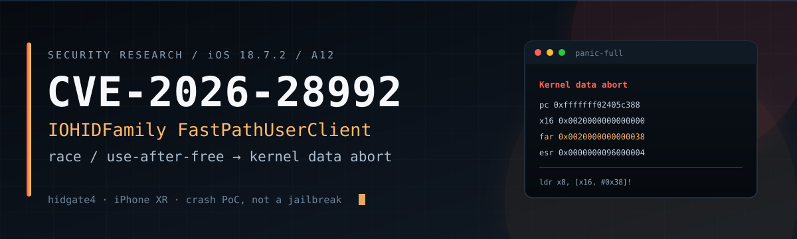
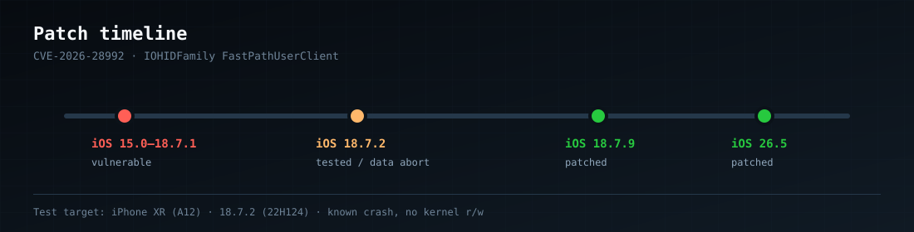
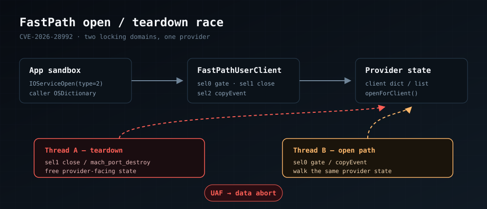
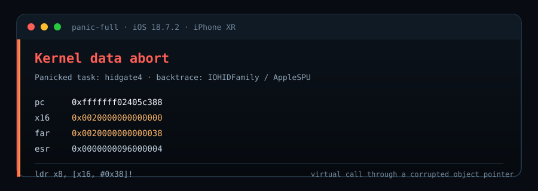

<p align="center">
  
</p>

<p align="center">
  
  
  
  
  <a href="https://github.com/nenasevartem70-cmyk/hidgate-poc/actions/workflows/build.yml"></a>
</p>

# CVE-2026-28992 — IOHIDFamily FastPathUserClient crash PoC

Standalone iOS proof-of-concept for the `IOHIDEventServiceFastPathUserClient`
race/UAF in IOHIDFamily. The PoC drives the fast-path open/teardown race and
reliably produces a **kernel data abort** on iOS 18.7.2 (A12 / iPhone XR).

> **This is a crash PoC, not a jailbreak.**
> It does not provide kernel read/write, does not bypass PAC/PPL/SPTM, and does
> not install anything. It intentionally panics the kernel and reboots the
> device.

## Status

| Item | Value |
|---|---|
| CVE | CVE-2026-28992 |
| Component | `com.apple.iokit.IOHIDFamily` — `IOHIDEventServiceFastPathUserClient` |
| Bug class | Race condition / use-after-free |
| Reachable from | Normal app sandbox, no entitlements required |
| Patched in | iOS 18.7.9 / iPadOS 18.7.9 and iOS 26.5 / iPadOS 26.5 |
| Tested on | iPhone XR (`iPhone11,8`), iOS 18.7.2 (22H124), A12 |
| Result | Kernel data abort / panic, device reboots |

The original research and PoC were published by **Johnny Franks
(@0xjohnny)**. This repository contains a standalone build of the same
technique, with service enumeration and a panic-log analysis from the
18.7.2/A12 target.

## Patch timeline

<p align="center">
  
</p>

## Root cause

`IOHIDEventServiceFastPathUserClient` gates `sel0` on the
`FastPathHasEntitlement` and `FastPathMotionEventEntitlement` keys in the
**caller-supplied OSDictionary**, instead of the entitlement flags stored
during `initWithTask`. A sandboxed app can therefore pass the gate by putting
those keys in its input dictionary.

Two connections to the same `IOHIDEventService` provider then operate in
different locking domains:

- `sel1` (close) drops provider state and clears `+0x109` without the lock;
- `sel2` (copyEvent) checks `+0x108` under a per-connection lock and then
  calls into the provider.

The AOP variant additionally uses `mach_port_destroy` on probe connections to
fire asynchronous `didTerminate`/teardown while opener threads walk the same
provider state.

<p align="center">
  
</p>

## What this PoC does

1. Enumerates every `IOHIDEventService` in the IORegistry.
2. Opens up to 32 `type=2` user clients per service and gates each one with
   the entitlement-bypass XML dictionary.
3. Picks the first provider with at least two successful gates.
4. Keeps eight gated connections.
5. Runs three `close`/reopen churn threads.
6. For 120 seconds, repeatedly opens 16 probe connections, gates them, and
   destroys them with `mach_port_destroy` (80 ms race window).

On the tested 18.7.2/A12 device, this crashes in the provider's
open/teardown path.

## Expected panic

```
Panicked task ... pid ...: hidgate4
Kernel data abort
pc  = 0xfffffff02405c388
x16 = 0x0020000000000000
far = 0x0020000000000038
esr = 0x96000004

0xfffffff008424388:  ldr x8, [x16, #0x38]!
```

<p align="center">
  
</p>

The faulting instruction is a virtual call through a corrupted object
pointer. The backtrace contains `IOHIDFamily` and `AppleSPU`, which is
consistent with the FastPath open/teardown race.

See [`docs/panic-analysis.md`](docs/panic-analysis.md) for the redacted
analysis.

## Build

No prebuilt `.ipa` is committed. Build it yourself from source and sign it
with your own certificate or sideloading tool.

### One command (macOS)

```bash
make
# or: ./build.sh
```

This produces:

```
build/Payload/hidgate4.app
build/hidgate4-unsigned.ipa
```

The IPA is unsigned. Sign it with your normal workflow (Xcode, `codesign`,
`ldid`, AltStore, TrollStore, etc.) before installing.

### Xcode

1. Create a new iOS App project (Objective-C, UIKit).
2. Replace `ViewController.m`/`main.m` with [`PoC/main.m`](PoC/main.m).
3. Add `IOKit.framework` and `Foundation.framework`.
4. Set a bundle identifier and sign with your development team.
5. Install on a test device you own and launch.

### Manual command line (macOS)

```bash
SDK=$(xcrun --sdk iphoneos --show-sdk-path)
xcrun -sdk iphoneos clang -arch arm64 -isysroot "$SDK" -fobjc-arc -fblocks \
  -O2 -c PoC/main.m -o main.o
xcrun -sdk iphoneos clang -arch arm64 -isysroot "$SDK" \
  -o hidgate4 main.o -framework UIKit -framework Foundation -framework IOKit
python3 scripts/package_ipa.py hidgate4.app hidgate4-unsigned.ipa
```

### GitHub Actions

The workflow in `.github/workflows/build.yml` builds an unsigned IPA on a
macOS runner and uploads it as the `hidgate4-unsigned-ipa` artifact. You can
run it manually from the Actions tab.

## Project page (GitHub Pages)

The `docs/` directory contains a self-contained dark landing page with the
banner, race diagram, panic card, and timeline.

To enable it:

1. Repository **Settings → Pages**
2. **Build and deployment → Deploy from a branch**
3. Branch `main`, folder `/docs`
4. Save

After that the page is available at:

**https://nenasevartem70-cmyk.github.io/hidgate-poc/**

Instant preview without enabling Pages:

**https://raw.githack.com/nenasevartem70-cmyk/hidgate-poc/main/docs/index.html**

## Warning

- Running this PoC **will** panic the kernel and reboot the device.
- Do not run it on a primary phone.
- Save your work first.
- The PoC is intentionally aggressive: 16 probe connections every 80 ms for
  120 seconds.

## Credits

- **Johnny Franks (@0xjohnny)** — discovery and original PoC:
  - https://github.com/0xjohnnydev/CVE-2026-28992-IOHIDFamily-FastPathUserClient-Race-Conditions
  - https://github.com/clogan9019-dotcom/IOHIDFamily-PoC-Research
- Apple Security Advisory: iOS 18.7.9 / iPadOS 18.7.9.

## License

MIT. See [`LICENSE`](LICENSE).
